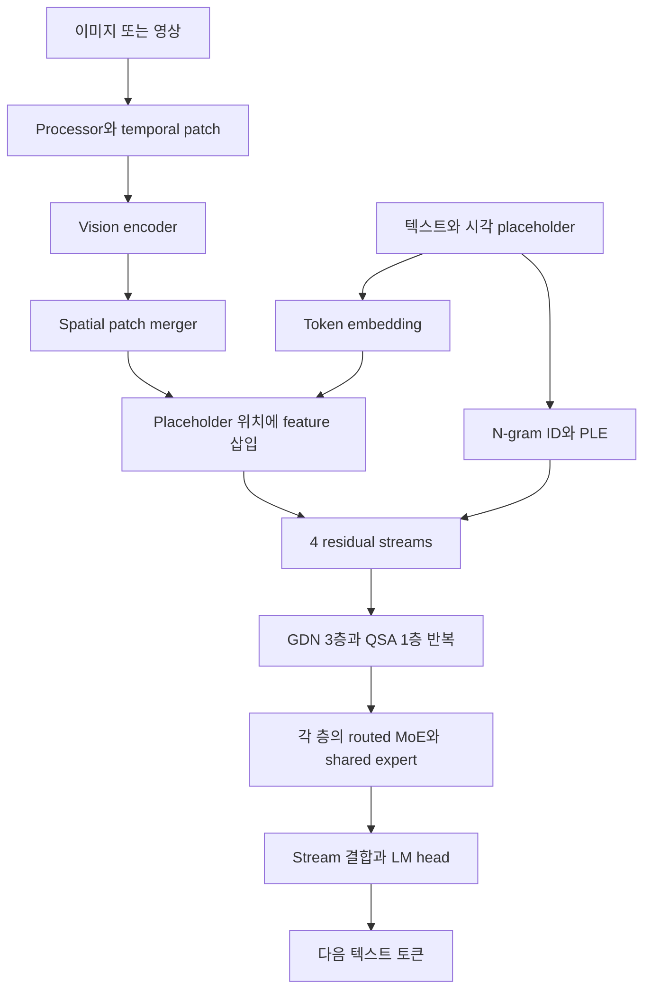

# 최종 도착점 — Qwen3.8-Flash-Next

[홈](../README.md) · [학습 순서](../curriculum/README.md) · [구현 명세](IMPLEMENTATION.md)

목표는 공개된 Qwen3.8-Flash-Next의 **텍스트·이미지·영상 입력에서 텍스트 생성까지의 주 경로**를 이해하고 작은 설정으로 구현하는 것입니다. 이름이 비슷한 Qwen3.8 모델 전체나 Omni 제품군을 동일한 구조로 취급하지 않습니다.

## 공식 근거

- [기술 보고서: On the Design of Qwen3.8-Next Architecture](https://arxiv.org/html/2608.30320v1)
- [모델 카드](https://huggingface.co/Qwen/Qwen3.8-Flash-Next/blob/de4b8e4d43b917e7706784d8bb445c9af86a3540/README.md) · [config.json](https://huggingface.co/Qwen/Qwen3.8-Flash-Next/blob/de4b8e4d43b917e7706784d8bb445c9af86a3540/config.json)
- [Transformers config 클래스](https://github.com/huggingface/transformers/blob/98110a1f5332a9ac5629ccc2aeb6412393df15e9/src/transformers/models/qwen4_exp/configuration_qwen4_exp.py) · [모델 구현](https://github.com/huggingface/transformers/blob/98110a1f5332a9ac5629ccc2aeb6412393df15e9/src/transformers/models/qwen4_exp/modeling_qwen4_exp.py)
- [이미지 processor 설정](https://huggingface.co/Qwen/Qwen3.8-Flash-Next/blob/de4b8e4d43b917e7706784d8bb445c9af86a3540/preprocessor_config.json) · [영상 processor 설정](https://huggingface.co/Qwen/Qwen3.8-Flash-Next/blob/de4b8e4d43b917e7706784d8bb445c9af86a3540/video_preprocessor_config.json)

Qwen의 [발표 저장소](https://github.com/QwenLM/Qwen3.8-Flash-Next)는 보고서와 안내의 출처입니다. 실제 독해용 모델 코드는 위 Transformers 구현을 사용합니다. 버전과 확인 한계는 [검증 기록](VERIFICATION.md)에 있습니다.

## 전체 데이터 흐름

그림은 개념 흐름입니다. **PLE는 지정된 decoder layer에서 주입**하고, GR은 각 attention/MoE sublayer 앞뒤에서 작동합니다. MoE를 전체 hybrid stack 뒤에 한 번만 붙이는 구조가 아닙니다. 정확한 순서는 DecoderLayer를 기준으로 그립니다.

## 설정에서 확인한 구성

아래 값은 링크한 checkpoint config 기준입니다. config의 `full_attention`이라는 layer 이름만 보고 dense attention이라고 판단하지 않습니다. 해당 class 내부에 QSA indexer가 있습니다.

| 구성 | config에서 확인한 값 | 직접 구현에서 볼 점 |
|---|---|---|
| 모델 | `Qwen4ExpForConditionalGeneration`, `qwen4_exp` | 이름이 Qwen4Exp여도 이 checkpoint의 구현 클래스임 |
| 텍스트 | 48층, hidden 2560 | 3 linear_attention + 1 full_attention 반복 |
| GDN | Q/K heads 16, V heads 48, head dim 128, conv 4 | projection·norm·gate·state shape |
| QSA core | Q heads 24, KV heads 2, head dim 256 | GQA와 output gate |
| Indexer | Q heads 4, KV head 1, dim 128, compression 4, budget 2048 | MQA block 선택과 tail |
| MoE | routed experts 512, top-10, shared intermediate 640 | routed 합산과 gated shared 경로 |
| GR | count 4, low rank 320 | stream별 read/write |
| N-gram/PLE | ngram_size 3, heads_per_ngram 8, base vocab 20M, layer_ids [2] | hash·EOS·층 번호·local conv |
| 위치 | partial rotary 0.25, interleaved MRoPE, sections [11,11,10] | core rotary dim 64와 시각 위치 |
| Vision | depth 27, hidden 1152, heads 16, patch16, temporal patch2 | Conv3d와 vision attention |
| 연결부 | spatial_merge_size 2, out_hidden_size 2560 | 2×2 묶음과 언어 폭으로 projection |
| DeepStack | deepstack_visual_indexes=[] | Qwen3-VL 논문에서 그대로 이식하지 않음 |
| MTP | config에 1층 명시 | 확인한 HF 본체는 MTP weight를 ignore함 |

모델 카드의 대규모 파라미터 수·원래 context 길이는 목표 제품의 사양입니다. 학습용 구현의 수용 메모리나 달성 성능으로 사용하지 않습니다.

## 코드로 연결하기

[공식 코드 지도](CODE_MAP.md)에서 구성요소별 class와 주차를 찾습니다. [환경 준비](ENVIRONMENT.md)와 [부분 연산 대조](PARITY.md)는 처음 필요해지는 주차에서 읽습니다.

## 혼동하지 않을 네 가지

1. **QSA core와 indexer:** core는 GQA, indexer는 MQA다. 이것을 MLA라고 부르지 않는다.
2. **GDN과 전체 hybrid:** GDN state는 길이에 대해 고정 크기여도 QSA의 KV/indexer 이력은 커질 수 있다.
3. **ViT/LLaVA와 목표 vision 경로:** 선수 개념을 배우는 논문이며, 그대로 붙이면 정확한 목표 구현이 되지는 않는다.
4. **의미를 재현하는 코드와 고속 kernel:** HF reference의 dense mask QSA를 구현해도 논문에서 보고한 sparse kernel 속도가 재현되는 것은 아니다.
